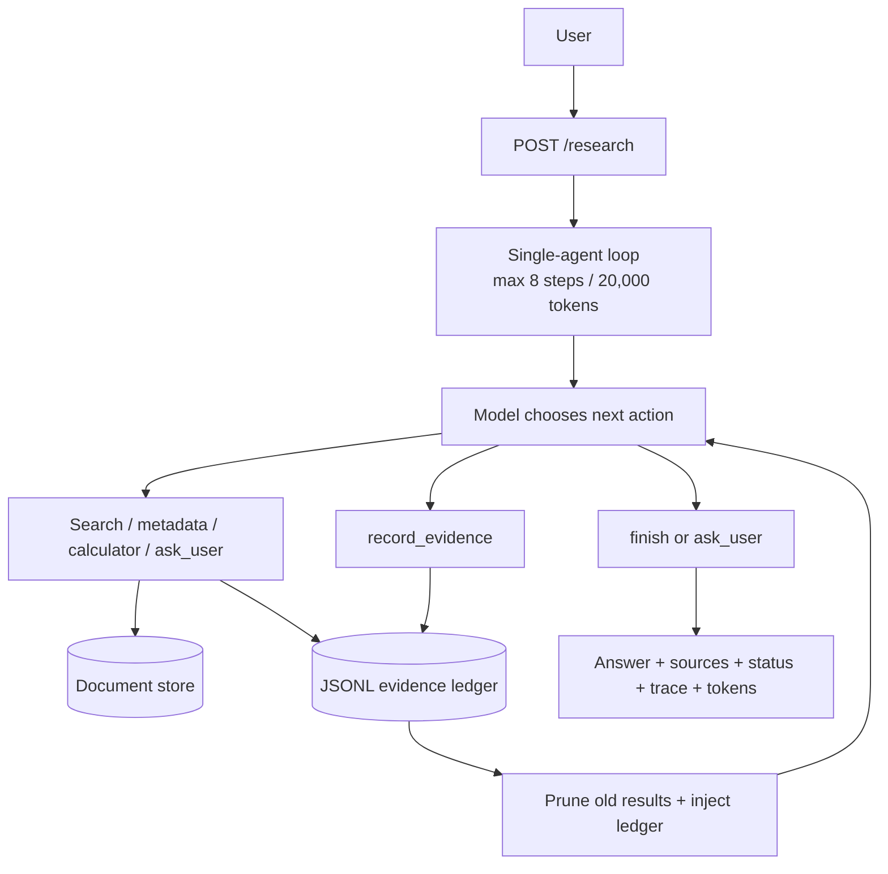

# Agentify the Assistant

This project extends the RAG assistant with a bounded agentic research feature. The research endpoint lets the model decide what to do next from the previous tool result: search another document, record supporting or conflicting evidence, ask for clarification, or finish. A fixed pipeline is insufficient because questions such as comparing the current Pro price with a draft sales sheet require the assistant to inspect one source, decide that a second source is relevant, reconcile the results, and only then answer.

## Running the assistant

Install the dependencies and configure the provider variables in `.env` from `.env.example`:

```bash
pip install -r requirements.txt
python run.py
```

The API exposes the W15 endpoints and the new `POST /research` endpoint. A research request has the form:

```json
{"question": "Compare the current Pro price with the draft sales sheet."}
```

The response includes the answer, evidence sources, confidence, status, stopping reason, number of steps, token usage, and the complete tool trace.

## Context Engineering Technique

The agent uses structured external notes plus tool-result clearing. Each `record_evidence` call appends a JSONL entry to `data/evidence_ledger.jsonl`. Before every model call, `prune()` replaces older tool payloads with a short marker, keeps only the two most recent tool results, and injects the current question’s ledger entries as a system note. This solves context saturation during multi-source research: raw search results can be verbose and are less durable than the claims and sources the agent has explicitly recorded. The ledger also provides a deterministic citation check; a final answer that cites a source not recorded during the current run is downgraded to `insufficient_evidence`.

Search results are additionally capped before they enter the trace or prompt, and the loop is bounded by eight steps and a 20,000-token budget.

## Agentic Pattern

This is a single-agent loop. One model owns the research state, evidence ledger, and stopping decision because the task is tightly coupled: the result of each search determines whether another source or an evidence-recording action is needed. Adding separate agents would add coordination and token overhead without useful parallelization for these short document searches. The design therefore avoids a sequential multi-agent bottleneck and skill dilution, while acknowledging the single-agent self-verification paradox: the same model records evidence and judges sufficiency. The ledger citation check and low-confidence fallback limit that risk.

The loop supports multiple iterations, chooses among `list_documents`, `lookup_document_metadata`, `search_document`, `calculate`, `record_evidence`, `ask_user`, and `finish`, and stops on `finish`/`ask_user`, a completion error, a token-budget breach, or the eight-step maximum.

### Skill vs. Agent

This capability could not be implemented adequately as a Skill alone: a Skill could describe how to research documents, but the runtime model must repeatedly choose and execute tools based on newly observed results, which requires the bounded agent loop.

## Evaluation Harness

[`eval/evaluate.py`](./eval/evaluate.py) is a dependency-light harness written from scratch; it does not use an evaluation framework. It drives the real `run_agent` function against the Northstar corpus with a deterministic planner whose next action depends on the observed trajectory. It measures task completion rate, tool-call correctness and argument presence, trajectory length, total tokens consumed per query, and failure class/trace.

The current report in [`eval/results.md`](./eval/results.md) records four scenarios:

| Scenario | Steps | Tokens | Result |
|---|---:|---:|---|
| Current Pro price vs. draft sales sheet | 5 | 50 | answered; conflicting sources reported |
| SSO and audit logs | 3 | 30 | answered |
| Missing uptime SLA | 3 | 30 | insufficient evidence |
| Pro price with injected search timeout | 3 | 30 | soft failure; insufficient evidence |

Overall task completion is **4/4 (100%)** and tool-call correctness is **4/4 (100%)**. The trajectory lengths are reasonable: the conflict requires two searches and two evidence records, while the direct and missing-evidence cases require fewer actions.

### Failure Injection Test

The harness sets `INJECT_FAILURE=search_document:timeout` for the Pro-price scenario. `safe_execute()` converts the timeout into a recorded tool error instead of crashing the loop. The agent does not cite either failed search, returns low confidence, and finishes with `insufficient_evidence`. The harness classifies this as a **soft failure** because the request completes safely without an unsupported confident answer. A tool exception that prevents a usable response is a hard failure; an error that causes later dependent actions to fail is a cascading soft failure.

## Tool vs. Agent Boundary

Document search, metadata lookup, calculation, evidence recording, clarification, and finalization are modeled as bounded tool calls. They are deterministic operations with one request/response result, so the research agent remains responsible for deciding whether and when to call them. The external LLM provider is also treated as a bounded completion call with fallback handling, rather than as an agent-to-agent interaction, because it does not own a separate goal, memory, or tool loop in this application.

## Architecture

The updated architecture diagram is in [`docs/agentic-architecture.md`](./docs/agentic-architecture.md):



## Deliverables

- Updated W15 assistant and agentic research implementation in [`app/`](./app/).
- Assignment documentation in this README.
- Agentic architecture diagram in [`docs/agentic-architecture.md`](./docs/agentic-architecture.md).
- Evaluation harness in [`eval/evaluate.py`](./eval/evaluate.py), corpus in [`eval/corpus/`](./eval/corpus/), and generated report in [`eval/results.md`](./eval/results.md).
