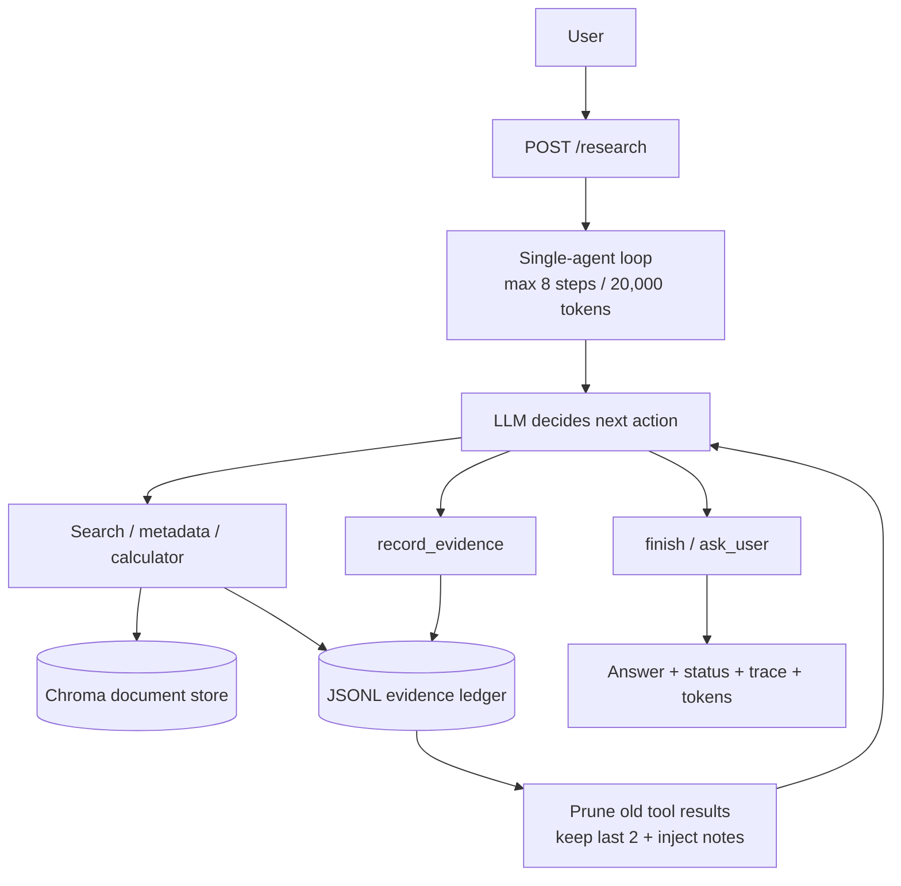

# Agentic research architecture

The loop is single-agent because searches, conflict resolution, and evidence
recording share one tightly coupled ledger. Search calls are fast and do not
create a useful parallelization opportunity. The main remaining risk is the
self-verification paradox: the same model records evidence and judges whether
it is sufficient. The deterministic citation check reduces that risk by
downgrading any answer whose cited source is absent from the ledger.
